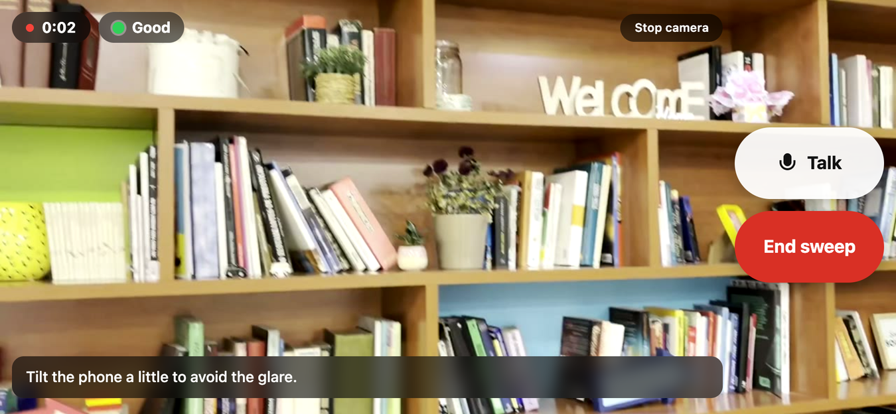
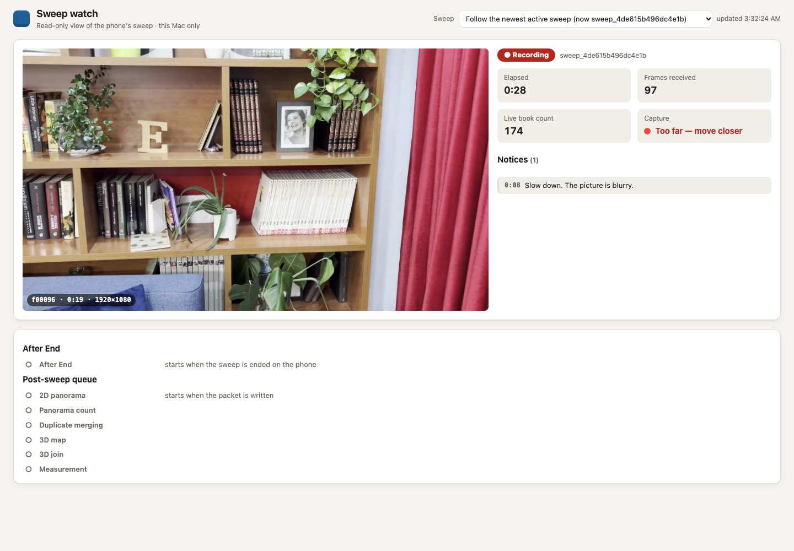

# shelf-sweep

shelf-sweep turns one slow phone-camera sweep of a home library into an itemised contents claim packet. While you walk the shelf,
the phone streams frames to a server on your Mac. The server detects every spine and non-book object, follows each book from frame to frame
and gives capture guidance on screen (slow down, move closer, go back), spoken too when voice is enabled. After the sweep it reads the spines, looks the titles up in public
catalogues, prices the physical editions with cited sources, builds a 2D panorama and a 3D map of the shelf face, and measures what the
geometry supports. The result is `claim_packet.json` plus an HTML/PDF report. Anything the evidence does not support stays explicitly
unknown, unpriced or "needs review"; it is never filled in.



## Quick start

Needs macOS or Linux, [`uv`](https://docs.astral.sh/uv/), Python 3.12, `ffmpeg`, `openssl` and Chrome/Chromium (PDF reports). Node 20+ is
needed only for the browser tests.

```bash
git clone <repo-url> shelf-sweep && cd shelf-sweep
cp .env.example .env                   # optional keys and settings; never commit .env
./scripts/setup_local_models.sh        # .venv + local detector/OCR weights (~1.3 GB, sha256-checked, resumable)
#   or: ./scripts/setup_local_models.sh --minimal   (app + local OCR only, no detector; a few minutes)

# the two servers (keep both running)
.venv/bin/python -m uvicorn app.server:app --host 127.0.0.1 --port 4182    # the site on the Mac
scripts/serve_https.sh                                                      # the same app over HTTPS for the phone (:4183)
```

No API key is needed: detection, reading and the maps run locally. A Gemini key in `.env` is optional (hosted reading and voice), see
[docs/configuration.md](docs/configuration.md).

## Recommended way to run a sweep

1. Start both servers (above). `scripts/serve_https.sh` prints a pairing link `https://<Mac LAN IP>:4183/?k=<key>` and the one-time steps
   to trust its local certificate on the iPhone. If it runs in the background, the link is in its log.
2. On the iPhone (same Wi-Fi as the Mac), open the pairing link in Safari and allow camera and microphone.
3. On the Mac, open the live watch page: <http://127.0.0.1:4182/watch>. It follows the phone's sweep: frames, live book count,
   capture notices, the conversation, and afterwards the post-sweep queue and the claim packet.
4. Hold the phone in landscape, close to the shelf, and make one slow pass (row by row). Tap **End sweep** when done.
5. The packet appears on the watch page and on <http://127.0.0.1:4182/>; the panorama, count, duplicate merging, 3D map and
   measurement run in the background and update it.



More detail (certificate trust, background servers, logs, recorded videos): [docs/setup.md](docs/setup.md).

## Pipeline stages from the command line

Every stage also runs automatically after a sweep; these commands run one stage on a saved run (`runs/<run>`). Outputs go to new
versioned directories next to the run; nothing is overwritten.

```bash
P=.venv/bin/python
$P -m app.replay --video sweeps/my_shelf.mov --out runs/my_replay                       # replay a recorded video through the live path
$P -m pipeline.panorama --source-run runs/<run> --out runs/<run>_panorama_v1            # 2D panorama of the shelf face
$P -m pipeline.panorama_count --run runs/<run> --panorama runs/<run>_panorama_v1 --attach   # spines counted on the panorama
$P -m pipeline.instances --run runs/<run> --attach                                     # merge track groups into physical books
$P -m pipeline.recon3d --source-run runs/<run> --out runs/<run>_recon3d_v1              # 3D map (pycolmap SfM)
$P -m app.measurement --run <run>                                                       # measurement on the newest 3D map
$P -m app.finish_reading --run runs/<run>                                               # read, resolve and price the groups left unread
```

Ground truth: <http://127.0.0.1:4182/truth?run=<run>> lets you hand-label titles, items and price checks for a sweep; answers are saved to
`ground_truth/` (git-ignored) and `scripts/ground_truth_sheet.py` builds a results workbook from them. Stage by stage:
[docs/pipeline.md](docs/pipeline.md).

## Tests

```bash
.venv/bin/python -m pytest tests -q        # checks that need saved runs/ skip when they are absent
node tests/client-regressions-app.cjs      # browser client regressions
node tests/client-regressions-pairs.cjs
```

## Tools used

- Detection: a YOLO oriented-box book-spine detector (`book-spine-best.pt`) and YOLO-World v2 with CLIP ViT-B/32 for non-book objects
  (Ultralytics, PyTorch), local CPU.
- Reading: RapidOCR (ONNX, local default), EasyOCR with the CRAFT text detector (local fallback), Apple Vision (optional, macOS),
  Florence-2 (optional plugin), Gemini Flash (optional hosted reader/detector and pair adjudication, opt-in).
- Voice: Gemini Live (optional, needs your own key and model id).
- Catalogues and prices: Open Library, Google Books, AbeBooks / Iberlibro listings, publisher pages (JSON-LD),
  ECB euro reference rates for currency conversion.
- Geometry: OpenCV (tracking, registration, panorama), pycolmap / COLMAP (3D map), three.js (3D view).
- App: FastAPI, Uvicorn, openpyxl (results workbook).

The `third_party/insurance_claim_live_agent_team/` directory is the reference app this project started from, kept with its licence.
